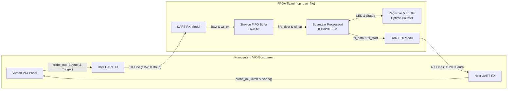

# 🚀 Day 03: Synchronous FIFO & UART Command Processor on FPGA

[](https://www.xilinx.com/)
[](https://www.xilinx.com/products/design-tools/vivado.html)
[](https://en.wikipedia.org/wiki/Verilog)
[](https://www.xilinx.com/)
[](https://www.xilinx.com/)

Ushbu loyiha FPGA (Field Programmable Gate Array) mikrosxemalarida **Sinxron FIFO (First-In-First-Out) navbat buferi**, **UART (Universal Asynchronous Receiver-Transmitter) qabul qiluvchi va uzatuvchi modullari** hamda **Buyruqlarni qayta ishlovchi avtomat (Finite State Machine - FSM)** integratsiyasini o'z ichiga oladi.

Loyiha **AMD Xilinx Vivado 2022.2** muhitida **Zynq UltraScale+ MPSoC (`xczu9eg-ffvb1156-2-i`)** arxitekturasi uchun sintez qilinib, **Vivado Simulator (XSim)** va **Vivado Hardware Manager (VIO)** orqali to'liq verifikatsiya qilingan.

---

## 📌 Mundarija

1. [Loyiha Arxitekturasi](#-loyiha-arxitekturasi)
2. [Buyruqlar Protokoli (Command Protocol)](#-buyruqlar-protokoli-command-protocol)
3. [Modullar Tavsifi](#-modullar-tavsifi)
   - [1. Sinxron FIFO (`fifo_sync.v`)](#1-sinxron-fifo-fifo_syncv)
   - [2. UART Qabul Qiluvchi (`uart_rx.v`)](#2-uart-qabul-qiluvchi-uart_rxv)
   - [3. UART Uzatuvchi (`uart_tx.v`)](#3-uart-uzatuvchi-uart_txv)
   - [4. Buyruqlar Protsessori (`cmd_processor.v`)](#4-buyruqlar-protsessori-cmd_processorv)
   - [5. Tizim Top Moduli (`top_uart_fifo.v`)](#5-tizim-top-moduli-top_uart_fifov)
4. [Simulyatsiya va Sinov Natijalari](#-simulyatsiya-va-sinov-natijalari)
5. [FPGA Apparat Sinovi (Vivado Hardware Manager & VIO)](#-fpga-apparat-sinovi-vivado-hardware-manager--vio)
6. [Loyihaning Fayllar Tuzilishi](#-loyihaning-fayllar-tuzilishi)
7. [Ishga Tushirish Qo'llanmasi](#-ishga-tushirish-qollanmasi)

---

## 🏗 Loyiha Arxitekturasi

Loyiha tizimi asinxron kelayotgan UART baytlarini yo'qotishsiz qabul qilish, ularni apparat FIFO buferida saqlash, FSM orqali buyruqlarni dekodlash va apparat registrlarini boshqarishga mo'ljallangan:



### Asosiy xususiyatlar:
- **Tizim soat chastotasi**: 100 MHz (Zynq PS dan ta'minlanadi)
- **UART aloqa tezligi**: 115200 baud (8 data bit, 1 stop bit, no parity)
- **FIFO bufer hajmi**: Parametrlashtirilgan (standart 16 chuqurlik, 8-bit kenglik)
- **Apparat himoyasi**: FIFO to'lganda overflow (ortiqcha yozish) va bo'sh bo'lganda underflow (bo'shdan o'qish) apparat darajasida to'silgan.
- **In-System Debug**: Tashqi FTDI konverter yoki jismoniy simlarsiz Vivado VIO orqali to'liq sinovdan o'tkazish.

---

## 📡 Buyruqlar Protokoli (Command Protocol)

Buyruqlar protsessori (`cmd_processor.v`) 1 yoki 2 baytli paketlarni qabul qilib, mos javoblarni qaytaradi:

| Buyruq KODI (Hex) | Buyruq Nomi | Argument (2-bayt) | FPGA Qaytaradigan Javob | Vazifasi / Izoh |
|:-----------------:|:-----------:|:-----------------:|:-----------------------:|:----------------|
| `0x01` | **PING** | Yo'q | `0xAA` | Aloqa borligini tekshirish (Heartbeat) |
| `0x02` | **SET_LEDS** | `Data` (8-bit) | Javob yo'q | Virtual LED registriga (`reg_leds`) qiymat yozish |
| `0x03` | **READ_LEDS** | Yo'q | `reg_leds` qiymati | Virtual LED registrining hozirgi holatini o'qish |
| `0x04` | **READ_COUNTER** | Yo'q | `uptime_counter` | FPGA ichki hisoblagichining joriy qiymatini o'qish |
| `0x05` | **MATH (x2)** | `Data` (8-bit) | `Data * 2` (`Data << 1`) | Berilgan sonni 2 ga ko'paytirib natijasini qaytarish |
| *Boshqa* | **UNKNOWN** | - | `0xEE` | Noma'lum buyruq yuborilganda xatolik kodi |

---

## 🧩 Modullar Tavsifi

### 1. Sinxron FIFO (`fifo_sync.v`)
- **Turi**: Circular Ring Buffer.
- **Ko'rsatkichlar**: Yozish (`wr_ptr`) va O'qish (`rd_ptr`) ko'rsatkichlari `ADDR_WIDTH + 1` bit o'lchamga ega. Eng yuqori bit (MSB) doiraviy aylanmani (wrap-around) bildiradi.
- **Holat bayroqlari**:
  - `empty = (wr_ptr == rd_ptr)` — FIFO bo'sh.
  - `full = (wr_ptr[ADDR-1:0] == rd_ptr[ADDR-1:0]) && (wr_ptr[ADDR] != rd_ptr[ADDR])` — FIFO to'liq.
  - `data_cnt = wr_ptr - rd_ptr` — joriy navbatdagi elementlar soni.

### 2. UART Qabul Qiluvchi (`uart_rx.v`)
- Asinxron RX liniyasidan kelayotgan ketma-ket ma'lumotni parallel 8-bitga aylantiradi.
- **Mid-bit Sampling**: Har bir bitning aynan o'rtasidan (`CLKS_PER_BIT / 2`) namuna oladi, bu esa fazaviy siljish va shovqinlarga nisbatan yuqori bardoshlilik beradi.

### 3. UART Uzatuvchi (`uart_tx.v`)
- 8-bit parallel baytni ketma-ket 115200 baud tezlikda uzatadi (Start bit '0', 8 ta ma'lumot biti LSB-dan boshlab, Stop bit '1').
- Sanoatda qabul qilingan yagona jarayonli (1-process) FSM asosida qurilgan.

### 4. Buyruqlar Protsessori (`cmd_processor.v`)
- 8 ta holatdan iborat Holatlar Mashinasi (FSM):
  - `S_IDLE` ➡️ `S_READ_CMD` ➡️ `S_WAIT_CMD` ➡️ `S_DECODE`
  - Argument talab qilinganda: `S_WAIT_ARG` ➡️ `S_FETCH_ARG` ➡️ `S_EXECUTE_ARG`
  - Javob uzatilganda: `S_WAIT_TX` ➡️ `S_IDLE`
- Tizimda mustaqil ishlovchi 24-bitli prescaler va 8-bitli `uptime_counter` o'rnatilgan.

### 5. Tizim Top Moduli (`top_uart_fifo.v`)
- Barcha quyi modullarni o'zaro bog'laydi.
- Vivado VIO (`vio_0`) IP yadrosi bilan integratsiya qilingan bo'lib, apparatda JTAG kabeli orqali interaktiv buyruqlar kiritish va javoblarni kuzatish imkonini beradi.

---

## 📊 Simulyatsiya va Sinov Natijalari

Vivado Behavioral Simulator yordamida tizimning barcha buyruqlar va uzatish bosqichlari to'liq verifikatsiya qilindi.

### 1. Testbench Waveform (End-to-End UART uzatish va qabul qilish)
Testbench orqali ketma-ket buyruqlar yuborilganda UART signallarining (`rx_line`, `tx_line`) va taktlar hisoblagichining sinxron ishlashi:


---

### 2. Start Biti va Mid-bit Namunasi Tafsilotlari
UART qabul qiluvchi liniyada tushuvchi front (`falling edge`) orqali Start bitini aniqlashi va barqaror qabul qilish jarayoni:


---

### 3. Baud Rate Sinxronizatsiyasi
100 MHz chastota ostida 115200 baud tezlik uchun `BIT_PERIOD` (868 takt) hisob-kitoblarining to'g'riligi tasdiqlandi:


---

### 4. `SET_LEDS` Buyrug'i Ijrosi (`reg_leds = 0xA5`)
`0x02` (`SET_LEDS`) buyrug'i ketidan `0xA5` argumenti yuborilganda, apparat registrida `reg_leds` qiymati `0xA5` ga o'zgarishi va barqaror saqlanishi:


---

## 🔬 FPGA Apparat Sinovi (Vivado Hardware Manager & VIO)

Loyiha Zynq UltraScale+ FPGA (`xczu9eg-ffvb1156-2-i`) chipiga yuklanib, Vivado Hardware Manager orqali real vaqt rejimida tekshirildi.

### Apparat Natijasi 1: VIO orqali Noma'lum Buyruq yuborilganda Xatolik (`0xEE`)
VIO interfeysi orqali `vio_tx_byte = 0x00` buyrug'i berilganda, FSM uni aniqlab, `last_resp_byte = 0xEE` xatolik kodini qaytardi:


---

### Apparat Natijasi 2: Javoblar Sanoq Registri (`resp_counter = 16`)
Ketma-ket yuborilgan buyruqlarga javoblar qabul qilinib, javob hisoblagichi `resp_counter = 16` ga yetishi ko'rsatilgan:


---

## 📁 Loyihaning Fayllar Tuzilishi

```text
Day03_FIFO/
├── .gitignore                    # Vivado vaqtincha fayllarini filtrlovchi qoida
├── README.md                     # Loyiha hujjatlari (ushbu fayl)
├── push_to_github.ps1            # GitHub'ga 1 ta buyruq bilan yuklash skripti
├── docs/
│   └── images/                   # Simulyatsiya va apparat natijalari skrinshotlari
│       ├── result_1.png
│       ├── result_2.png
│       ├── result_3.png
│       ├── result_4.png
│       ├── result_5.png
│       └── result_6.png
└── FIFO/
    ├── FIFO.xpr                  # Vivado 2022.2 loyiha fayli
    ├── rtl/                      # Toza RTL manba kodlari (Verilog)
    │   ├── cmd_processor.v       # FSM buyruqlar interpretatori
    │   ├── fifo_sync.v           # Parametrlangan sinxron FIFO
    │   ├── top_uart_fifo.v       # Tizim top darajasi
    │   ├── uart_rx.v             # UART qabul qiluvchi modul
    │   └── uart_tx.v             # UART uzatuvchi modul
    ├── tb/                       # Verifikatsiya testbench fayllari
    │   ├── tb_fifo_sync.v        # FIFO alohida unit-testi
    │   └── tb_top_uart_fifo.v    # Tizim integratsion simulyatsiyasi
    └── FIFO.srcs/                # Vivado manbalari, IP (FIFO, VIO) va Block Design
```

---

## 🚀 Ishga Tushirish Qo'llanmasi

### Vivado da loyihani ochish:
1. **AMD Xilinx Vivado 2022.2** dasturini oching.
2. `File` ➡️ `Project` ➡️ `Open...` tugmasini bosing va quyidagi faylni tanlang:
   ```text
   FIFO/FIFO.xpr
   ```
3. **Simulyatsiyani ishga tushirish**:
   - Chap panelda `Simulation` ➡️ `Run Simulation` ➡️ `Run Behavioral Simulation` tugmasini bosing.
4. **Sintez va Bitstream generatsiyasi**:
   - Chap panelda `Program and Debug` ➡️ `Generate Bitstream` tugmasini bosing.
5. **FPGA ga yuklash va VIO ni ochish**:
   - Plataning JTAG kabelini ulang.
   - `Open Hardware Manager` ➡️ `Open Target` ➡️ `Program Device`.
   - `hw_vio_1` boshqaruv panelida `vio_tx_byte` ga buyruq kiriting va `vio_send_btn` ni 1 ga o'zgartirib bajaring.

---

## 👨‍💻 Muallif

- **Loyiha**: FPGA RTL Design & Verification (Day 03)
- **Tizim**: AMD Xilinx Vivado 2022.2 | Verilog HDL | Zynq UltraScale+
