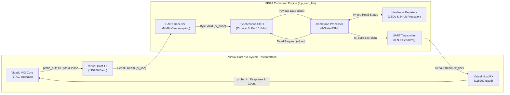
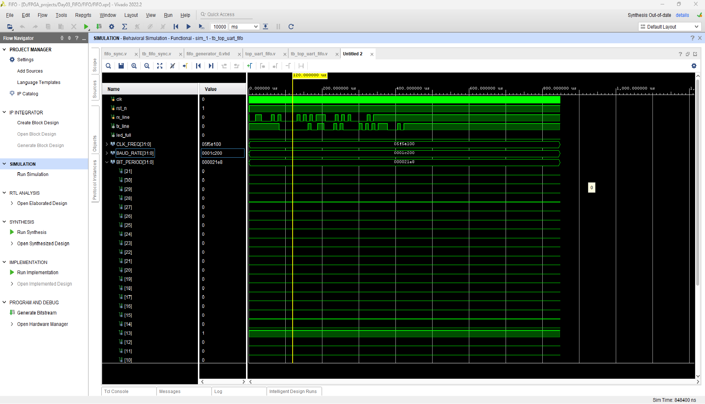
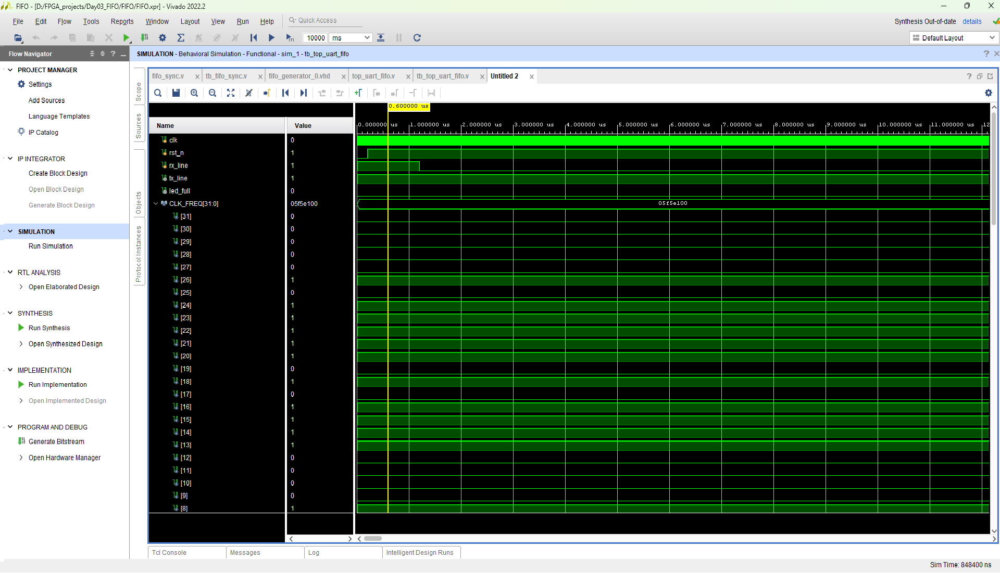
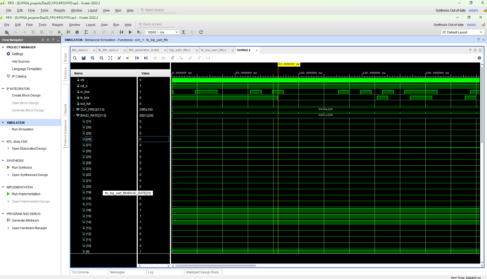
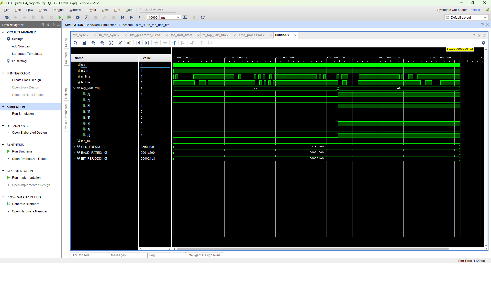
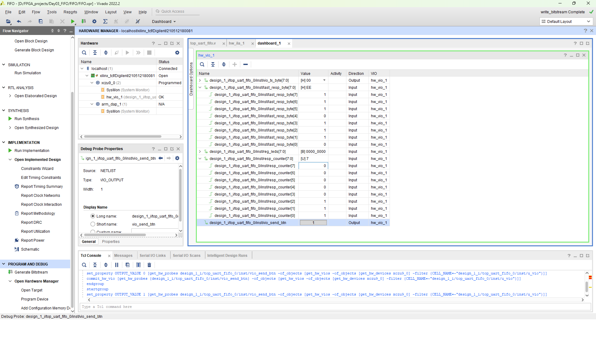
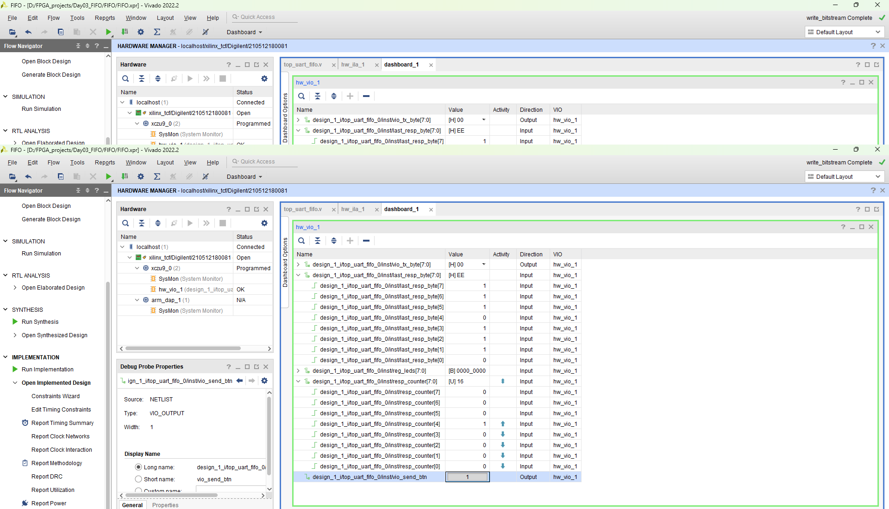

# FPGA UART FIFO Command Processor

[](https://www.xilinx.com/)
[](https://www.xilinx.com/products/design-tools/vivado.html)
[](https://en.wikipedia.org/wiki/Verilog)
[](https://www.xilinx.com/)
[](https://www.xilinx.com/)

An industrial-grade, fully synchronous FPGA subsystem featuring a parameterized **Synchronous FIFO buffer**, full-duplex **UART interface (8-N-1)**, and a robust **Finite State Machine (FSM) Command Processor**. The architecture decouples external serial communication baud rates from high-frequency internal system clock domains, safely buffering incoming payloads and executing hardware control instructions.

Designed, synthesized, and implemented for the **AMD Xilinx Zynq UltraScale+ MPSoC (`xczu9eg-ffvb1156-2-i`)** using **Vivado Design Suite 2022.2**. Fully verified through dual-layer verification: extensive behavioral simulation testbenches and in-system hardware debugging via Xilinx Virtual Input/Output (VIO).

---

## Key Engineering Highlights

- **Baud-Rate Decoupling**: Seamlessly interfaces a 115200 baud serial stream with a 100 MHz internal FPGA fabric clock without packet loss or pipeline stalls.
- **Robust Pointer-Based FIFO Architecture**: Implements an $N$-bit circular ring buffer utilizing $(N+1)$-bit write and read pointers. This enables unambiguous distinction between completely full and empty states without sacrificing a memory word.
- **Mid-Bit UART Sampling**: Receiver logic samples incoming data at the exact temporal center of each bit period (`CLKS_PER_BIT / 2`), ensuring high noise immunity and clock skew tolerance.
- **Modular Multi-Byte FSM Engine**: A deterministic 8-state command decoder that processes both single-byte queries and multi-byte command-argument packets with bounded latency and default error trap logic.
- **Hardware-in-the-Loop Verification**: Complete on-chip virtual loopback architecture integrated with Xilinx VIO, allowing real-time interactive debugging via JTAG without requiring physical external USB-to-UART bridge dongles.

---

## System Architecture

The hardware core is composed of four decoupled functional stages: serial reception, elastic buffering, packet parsing/execution, and serial transmission.



### Architectural Specifications:
- **System Clock**: 100.00 MHz ($T_{clk} = 10\text{ ns}$) generated by the Zynq UltraScale+ Processing System (PS).
- **UART Baud Rate**: 115,200 bps ($\approx 868\text{ clock cycles per bit}$).
- **FIFO Capacity**: 16 entries (configurable to any power of two, $2^N$), 8-bit data width.
- **Hardware Protections**: Integrated hardware overflow prevention (writes ignored when `full = 1`) and underflow protection (reads ignored when `empty = 1`).

---

## Command Set & Packet Protocol

The command processor interprets incoming bytes as operation codes (opcodes). Multi-byte commands dynamically stall the state machine until their subsequent argument bytes are received from the FIFO:

| Opcode (Hex) | Command Name | Payload / Argument | Expected Response | Description |
|:---:|:---:|:---:|:---:|:---|
| `0x01` | `CMD_PING` | None | `0xAA` | Link integrity check (Heartbeat acknowledgment) |
| `0x02` | `CMD_SET_LEDS` | 1 Byte (`[7:0] data`) | None | Updates the physical/virtual 8-bit LED register |
| `0x03` | `CMD_READ_LEDS` | None | Current `reg_leds` value | Reads back the current state of the LED register |
| `0x04` | `CMD_READ_COUNTER` | None | `uptime_counter[7:0]` | Reads the running 8-bit uptime tick counter |
| `0x05` | `CMD_MATH_X2` | 1 Byte (`[7:0] val`) | `val << 1` ($val \times 2$) | Multiplies input operand by 2 via arithmetic shift |
| *Other* | `INVALID_CMD` | N/A | `0xEE` | Fallback trap for unmapped opcodes (Error indicator) |

---

## Module Descriptions & Design Methodology

### 1. Parameterized Synchronous FIFO (`fifo_sync.v`)
- **Memory Organization**: Dual-port register array `mem[0:FIFO_DEPTH-1]`.
- **Pointer Arithmetic**: Write pointer (`wr_ptr`) and read pointer (`rd_ptr`) are sized to `ADDR_WIDTH + 1` bits (e.g., 5 bits for a depth of 16).
- **Flag Generation**:
  - `empty = (wr_ptr == rd_ptr)`
  - `full  = (wr_ptr[ADDR-1:0] == rd_ptr[ADDR-1:0]) && (wr_ptr[ADDR] != rd_ptr[ADDR])`
  - `data_cnt = wr_ptr - rd_ptr`
- **Protection Logic**: Hardware write enable is gated by `!full`; read enable is gated by `!empty`. Invalid operations produce no side effects.

### 2. UART Receiver Core (`uart_rx.v`)
- **Framing**: Standard 8-N-1 (1 Start Bit, 8 Data Bits, 1 Stop Bit, No Parity).
- **Desynchronization Filter**: Detects initial falling edge on the serial line.
- **Mid-Bit Sample Clock**: Counts up to `CLKS_PER_BIT - 1` (868 cycles at 100 MHz). Samples the line at `(CLKS_PER_BIT - 1) / 2` (cycle 434) to capture data at maximum eye diagram opening.
- **Output Handshake**: Asserts single-cycle pulse `rx_done` when a complete byte is reconstructed in `rx_data`.

### 3. UART Transmitter Core (`uart_tx.v`)
- **Design Pattern**: Single-process synchronous state machine ensuring glitch-free serial line driving.
- **States**: `STATE_IDLE`, `STATE_START`, `STATE_DATA`, `STATE_STOP`.
- **Serialization**: Shifts out stored data register LSB first.
- **Handshaking**: Asserts `tx_busy` during transmission to throttle upstream logic.

### 4. Command Processor FSM (`cmd_processor.v`)
- **State Flow**:
  - `S_IDLE`: Waits for `!fifo_empty && !tx_busy`.
  - `S_READ_CMD`: Asserts `fifo_rd_en = 1` for 1 cycle.
  - `S_WAIT_CMD`: Pipeline delay cycle allowing registered FIFO memory output to settle.
  - `S_DECODE`: Evaluates `current_cmd`. Direct single-byte commands set up transmission; parameterized commands transition to `S_WAIT_ARG`.
  - `S_WAIT_ARG`: Waits for argument byte to enter FIFO.
  - `S_FETCH_ARG` & `S_EXECUTE_ARG`: Reads argument, computes result (e.g. `fifo_dout << 1` or writes to `reg_leds`), and loads TX register.
  - `S_WAIT_TX`: Dispatches byte to UART transmitter and returns to `S_IDLE`.
- **Hardware Counter**: Integrated 24-bit prescaler divides system clock to drive a periodic 8-bit `uptime_counter`.

### 5. Top-Level Integration & In-System Testbench (`top_uart_fifo.v`)
- Instantiates a virtual PC host transmitter (`u_host_tx`) driven by VIO probes.
- Connects host serial stream to the internal FPGA receiver, through the FIFO buffer and command processor, and transmits responses back to host receiver (`u_host_rx`).
- Bridges signals to AMD Xilinx Virtual I/O (`vio_0`) for live runtime probing via JTAG.

---

## Simulation & Verification

The project includes multi-tiered verification environments using Vivado Behavioral Simulator (XSim).

### 1. FIFO Unit Verification (`tb_fifo_sync.v`)
- **Burst Fill Test**: Sequentially writes 16 bytes (`0xA0` through `0xAF`). Asserts that `full` flag activates precisely at capacity and `data_cnt = 16`.
- **Overflow Immunity Test**: Issues write strobe to full FIFO; validates data pointers remain invariant and memory is uncorrupted.
- **Burst Drain Test**: Sequentially reads all 16 bytes; verifies returned data order (FIFO property) and that `empty` flag asserts when drained.

---

### 2. Full-System Behavioral Waveform Analysis

The integrated testbench (`tb_top_uart_fifo.v`) evaluates complete serial loopback transactions:

#### Full Transaction Waveform Overview
Demonstrates transmission of multi-byte command streams over UART, FIFO buffering, FSM dispatch, and serialized response generation:


#### Start Bit Detection & Synchronization Timing
Close-up view of the UART receiver detecting the start bit edge and maintaining baud interval alignment:


#### Baud Rate Timing Verification (868 Clock Cycles per Bit)
Validation of the bit period counter (`BIT_PERIOD = 868`) matching 115,200 baud under a 100 MHz reference clock:


#### Multi-Byte Command Execution (`CMD_SET_LEDS`)
Behavioral simulation showing opcode `0x02` followed by payload byte `0xA5`, leading to `reg_leds` being updated to `0xA5`:


---

## Hardware In-System Verification (Vivado Hardware Manager & VIO)

The synthesized design was deployed on real silicon: **AMD Xilinx Zynq UltraScale+ MPSoC (`xczu9eg-ffvb1156-2-i`)** via a Digilent JTAG interface. Verification was conducted using the **Vivado Hardware Manager VIO Dashboard**.

### Hardware Test 1: Invalid Opcode Trap Detection (`0xEE`)
Injecting unmapped command byte `0x00` via VIO output probe `vio_tx_byte[7:0]` triggers the default branch in the command processor FSM, returning error code `last_resp_byte = 0xEE`:



---

### Hardware Test 2: Sequential Execution & Response Tracking (`resp_counter = 16`)
Consecutive command packets were stimulated through the JTAG VIO interface. The response counter register incrementally tracked 16 successfully completed transactions, verifying that the FIFO pipeline prevents dropped requests during rapid bursts:



---

## Repository Structure

```text
├── .gitignore                    # Vivado temporary & build artifact exclusion rules
├── README.md                     # Comprehensive technical documentation
├── push_to_github.ps1            # Automated single-command GitHub publish script
├── push_to_github.bat            # Windows batch launcher for GitHub upload
├── docs/
│   └── images/                   # Converted high-resolution simulation & hardware verification assets
│       ├── result_1.png          # Behavioral simulation overview
│       ├── result_2.png          # UART RX edge detection waveform
│       ├── result_3.png          # Baud rate interval timing verification
│       ├── result_4.png          # Multi-byte command execution waveform
│       ├── result_5.png          # Live hardware VIO error response (0xEE)
│       └── result_6.png          # Live hardware VIO response counter tracking
└── FIFO/
    ├── FIFO.xpr                  # Vivado 2022.2 project file
    ├── rtl/                      # Clean synthesizable RTL Verilog source files
    │   ├── cmd_processor.v       # 8-state FSM command interpreter
    │   ├── fifo_sync.v           # Parameterized synchronous circular FIFO
    │   ├── top_uart_fifo.v       # Top-level integration & VIO test wrapper
    │   ├── uart_rx.v             # Mid-bit sampling UART receiver
    │   └── uart_tx.v             # Single-process FSM UART transmitter
    ├── tb/                       # Behavioral verification testbenches
    │   ├── tb_fifo_sync.v        # Standalone FIFO unit testbench
    │   └── tb_top_uart_fifo.v    # Full-system loopback testbench
    └── FIFO.srcs/                # Vivado source management, IP cores, and Block Designs
        ├── sources_1/bd/         # Zynq UltraScale+ Processing System block design
        └── sources_1/ip/         # Xilinx IP cores (FIFO Generator, VIO)
```

---

## Build & Implementation Guide

### Prerequisites
- **EDA Tool**: AMD Xilinx Vivado Design Suite 2022.2 (or newer)
- **Target Part**: `xczu9eg-ffvb1156-2-i` (Zynq UltraScale+ MPSoC)

### Opening the Project in Vivado
1. Launch Vivado 2022.2.
2. In the Tcl Console, navigate to the project directory and open the project:
   ```tcl
   cd D:/FPGA_projects/Day03_FIFO/FIFO
   open_project FIFO.xpr
   ```

### Running Behavioral Simulation
To run the automated behavioral testbenches directly from the Vivado GUI or Tcl Console:
```tcl
# Run FIFO unit-level simulation
launch_simulation -simset sim_1

# Run full system loopback simulation
set_property top tb_top_uart_fifo [get_filesets sim_1]
launch_simulation -simset sim_1
run -all
```

### Bitstream Generation & Hardware Programming
1. Generate the bitstream:
   ```tcl
   launch_runs impl_1 -to_step write_bitstream -jobs 8
   wait_on_run impl_1
   ```
2. Program the FPGA device:
   ```tcl
   open_hw_manager
   connect_hw_server
   open_hw_target
   current_hw_device [get_hw_devices xczu9_0]
   set_property PROGRAM.FILE {FIFO.runs/impl_1/design_1_wrapper.bit} [get_hw_devices xczu9_0]
   set_property PROBES.FILE {FIFO.runs/impl_1/design_1_wrapper.ltx} [get_hw_devices xczu9_0]
   program_hw_devices [get_hw_devices xczu9_0]
   ```
3. Open the `hw_vio_1` dashboard to interact with the design in real time.
